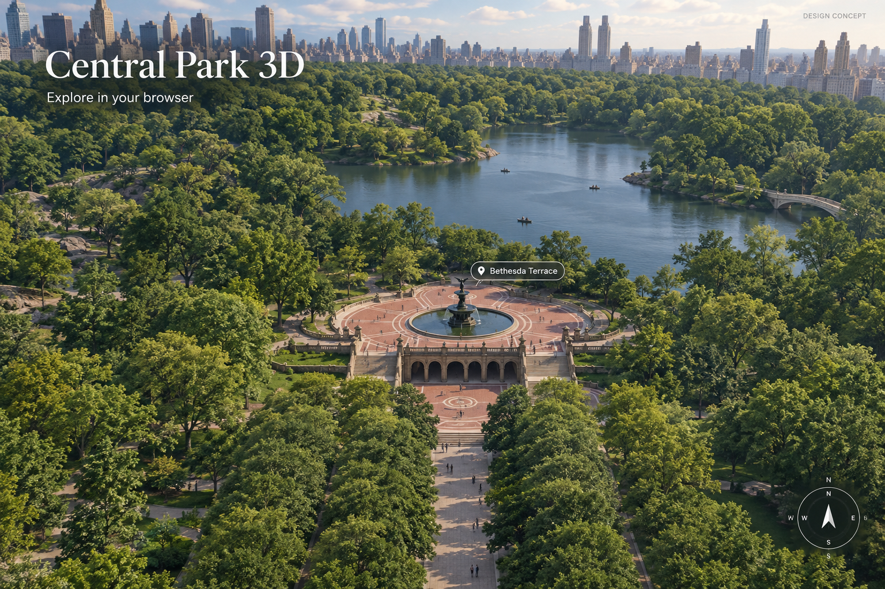
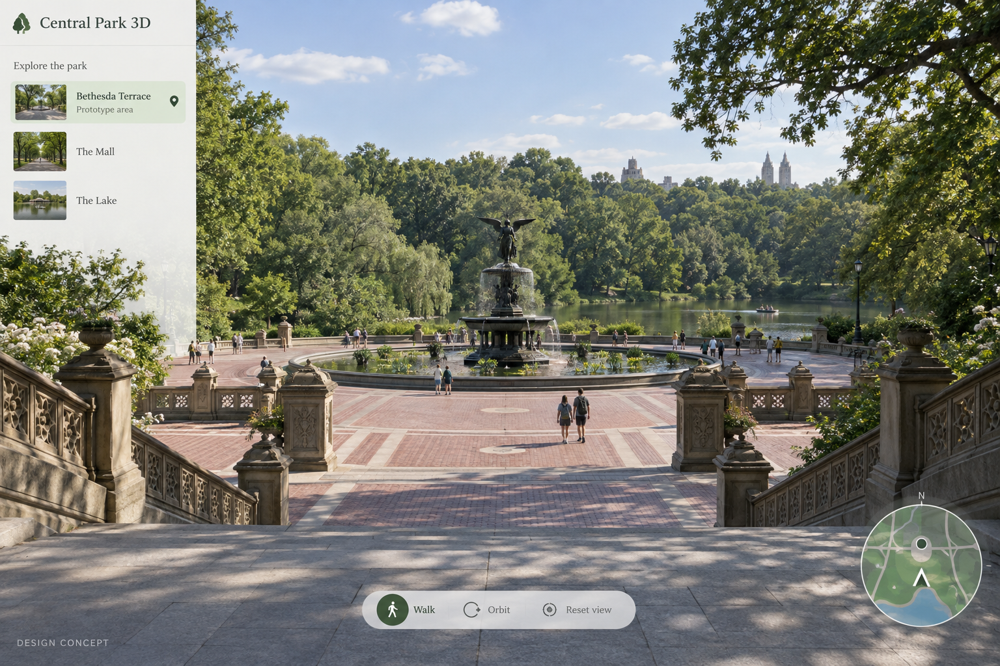
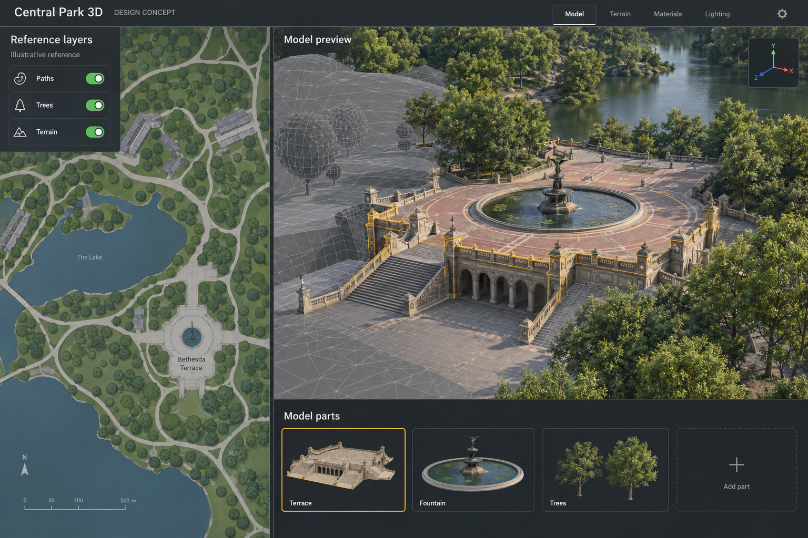

# Central Park 3D

Build a navigable 3D model of New York's Central Park and serve it online for browser exploration.

> Planning-stage project. The artwork below consists of AI-generated design concepts with synthetic content; it is not a screenshot of working software or a commitment to every pictured feature.

## First milestone

A recognizable Bethesda Terrace and Fountain area with surrounding paths, trees and a working browser viewer.

## Starting work

- [ ] Research geographic references and record their source, permissions and uncertainty.
- [ ] Model the terrace, fountain, terrain, paths and trees as modular assets.
- [ ] Build browser loading, walk/orbit navigation and a reset-view control.
- [ ] Optimize the first area for practical loading and document a hosting approach.

Use GitHub Issues for actionable work and discussion, and pull requests for reviewable changes. Repository access and merge authority follow this repository's GitHub permissions. Joining a Karma42 project does not grant repository write access. No live agent execution is started by creating this repository.

## Design concepts

### Walking and exploring the first area

### Reference layers and modular 3D modeling

## Artwork and open choices

Generated with the built-in image generator. See [the prompts and provenance](assets/prompts.json). Generated examples, reference layers, names, counts and observations are illustrative. The owner has not yet selected a source-code or asset license; no license grant is added by this initial repository setup.

## Status

Project brief and artwork only. Runnable implementation, hosting and friend participation remain future work. Creating this repository does not resume the paused friends cloud experiment.

---

Initial project brief and artwork prepared with AI assistance for the Karma42 owner, 10 October 2026.
