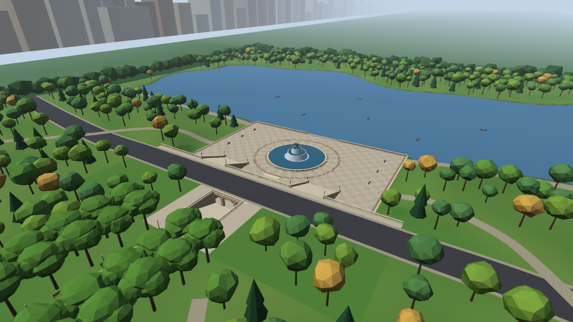
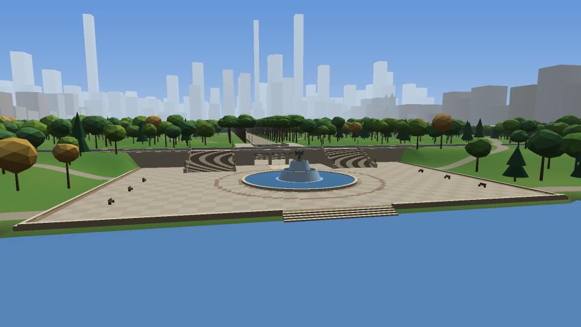
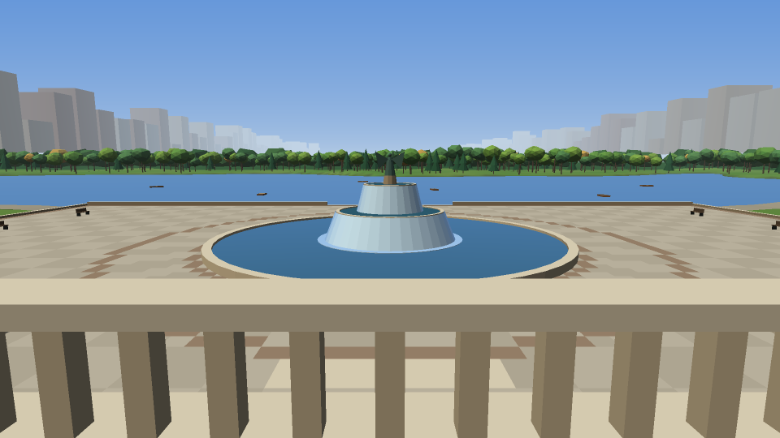
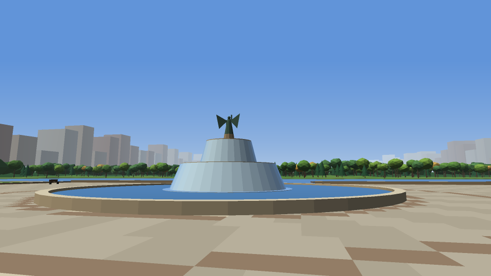
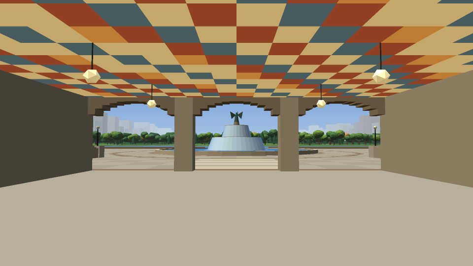
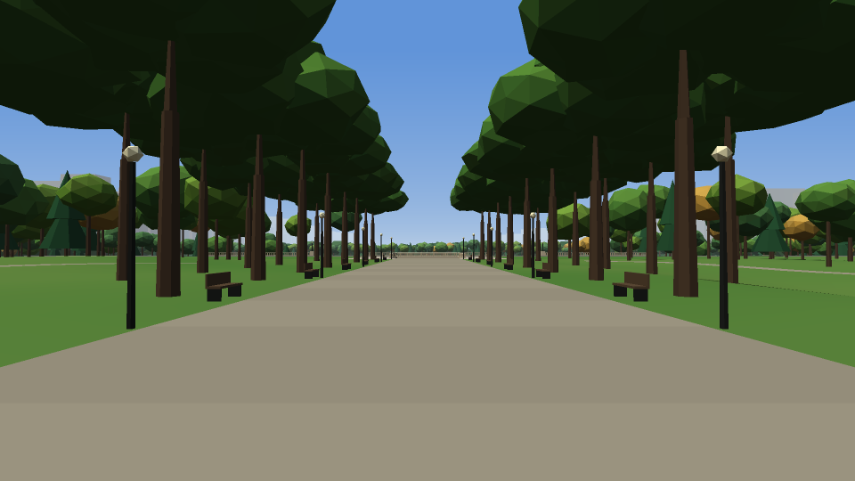

# Milestone 1 evidence: Bethesda Terrace & Fountain

Tracking issue: #1. Everything here was produced by an AI agent (Karma42 agent `cp3d-builder`, Claude Code / claude-opus-5-5) and is awaiting owner review. No human has reviewed it yet.

## What was built

| Area | Where | Notes |
|---|---|---|
| Site layout and terrain | `viewer/src/site.js` | Park-aligned frame, two-level terrace, Lake basin, paths, walkable surfaces |
| Modular scene components | `viewer/src/scene.js` | `terrain`, `lake`, `plaza`, `fountain`, `fountain-water`, `terrace`, `arcade-ceiling`, `paths`, `mall`, `trees`, `boats` |
| Context | `viewer/src/surroundings.js` | Tree belt, the rest of the park as canopy, an illustrative skyline |
| Browser viewer | `viewer/index.html`, `viewer/src/{main,renderer,camera}.js` | WebGL 1, no dependencies. Loading screen, orbit and walk modes, reset view, six viewpoints, keyboard, mouse and touch |
| Tooling | `tools/serve.mjs`, `tools/render-preview.mjs`, `tools/scene-stats.mjs` | Local server, offline preview renderer, statistics |
| Tests | `tests/*.test.mjs` | 37 tests (`npm test`) |
| References | `docs/references.md` | Assumed facts, sources to verify, uncertainty |
| Hosting | `docs/hosting.md` | Static-hosting proposal; nothing deployed |

## How to review

```sh
npm test      # 37 tests: geometry, layout, scene, navigation, renderer call flow, UI boot, server
npm start     # then open http://localhost:8080/  (or #view=fountain, #view=arcade, ...)
npm run stats
npm run preview -- --out /tmp/cp3d   # regenerate the images below
```

Requires Node.js 20 or later and no `npm install`.

In the viewer:
- **Reset view** returns to the overview.
- **Mode** switches between orbit and walk.
- **View** jumps to a preset; keys 1–6 do the same.
- `H` shows help.

In walk mode you can descend the grand staircases, pass through the arcade, climb the central stairs to the Mall, and sit on the fountain rim. The pool, the Lake and the terrace wall block movement.

## Preview images

These are **offline software renders** made by `tools/render-preview.mjs` from the same scene data and camera presets as the browser viewer, with approximately the same lighting. They are **not browser screenshots**. The real WebGL output also has animated water ripples and specular highlights.

| Overview | From the Lake |
|---|---|
|  |  |
| **Terrace overlook** | **Fountain** |
|  |  |
| **Arcade (Minton tile ceiling)** | **The Mall** |
|  |  |

## Scene statistics (`npm run stats`)

```
Component            Material   Triangles
terrain              standard       31792
lake                 water              2
plaza                standard       12608
fountain             standard        1392
fountain-water       water            424
terrace              standard        7068
arcade-ceiling       lamplit          816
paths                standard        1972
mall                 standard        2848
trees                standard      145440
boats                standard         120
surroundings         standard       15068
total                              219550
trees: 1256 (of which Mall elms: 112)
vertex data: 22.6 MiB, built in 105 ms (Node)
```

## Verification done in this session

- `npm test`: 37/37 passing. Coverage includes:
  - outward-facing geometry and finite vertex data;
  - fountain size and position;
  - stairs that climb monotonically with risers of 20 cm or less;
  - trees kept off paths and out of the water;
  - walking down the stairs, through the arcade and up to the Mall;
  - the wall and pool blocking movement, and falling under gravity;
  - reset;
  - the renderer's call flow against a mock WebGL context;
  - booting `main.js` against stub DOM objects;
  - the static server and its path-traversal guard.
- Offline preview renders of all six viewpoints (above).

## Not verified / known limitations

- **No real browser was run in this session.** No browser automation was available, so WebGL shader compilation and on-screen rendering are untested. The tests check JavaScript logic and call flow only. Owner check needed: open the viewer in a desktop browser and confirm it renders, then try a phone.
- Frame rate on real hardware has not been measured.
- Dimensions and positions are approximate and unverified (see `docs/references.md`).
- The style is low-poly and untextured: no ornament, people or seasonal variation.
- No license has been chosen for the code; the README notes this is the owner's choice.
