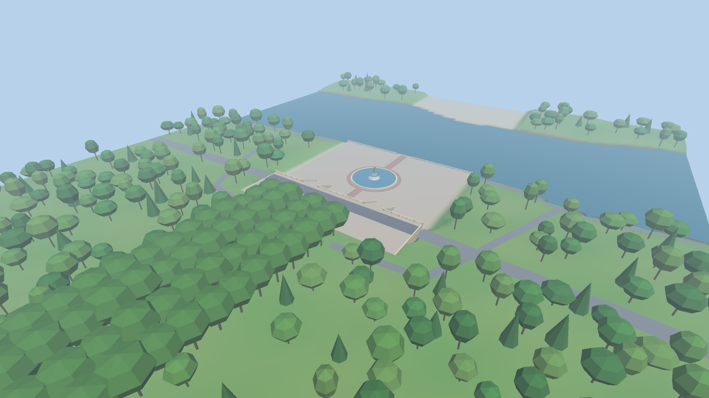
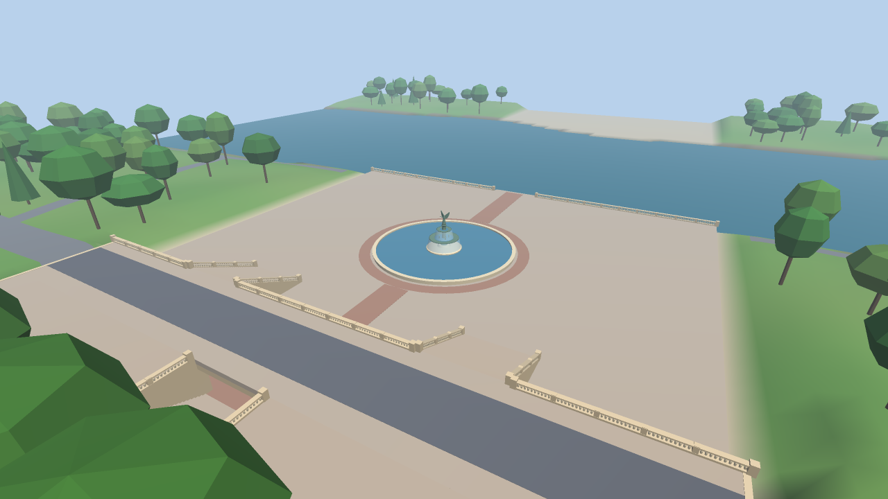
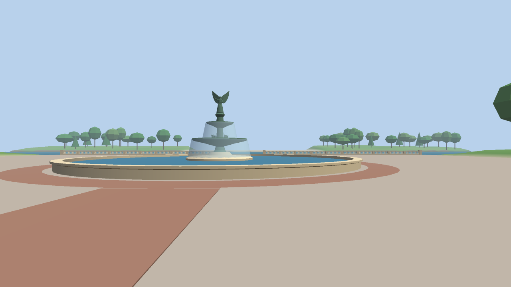
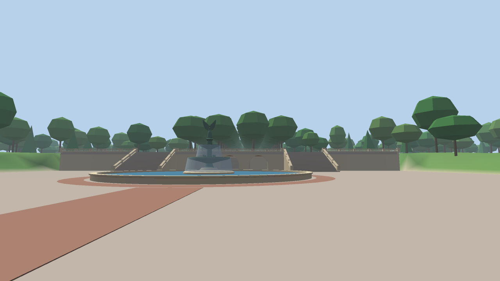
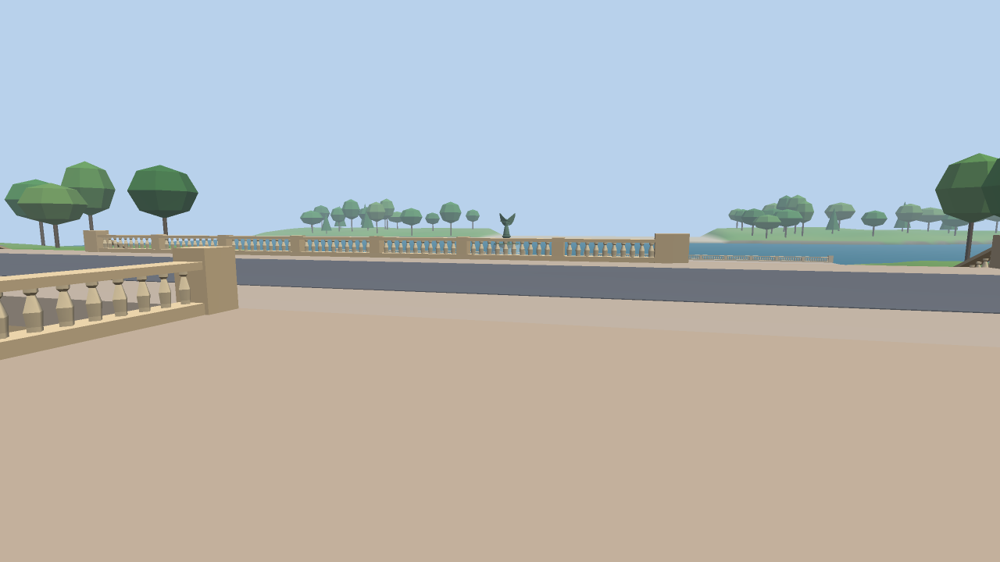
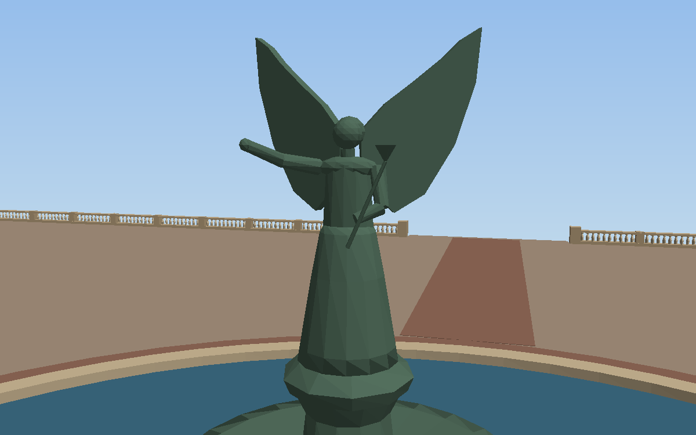
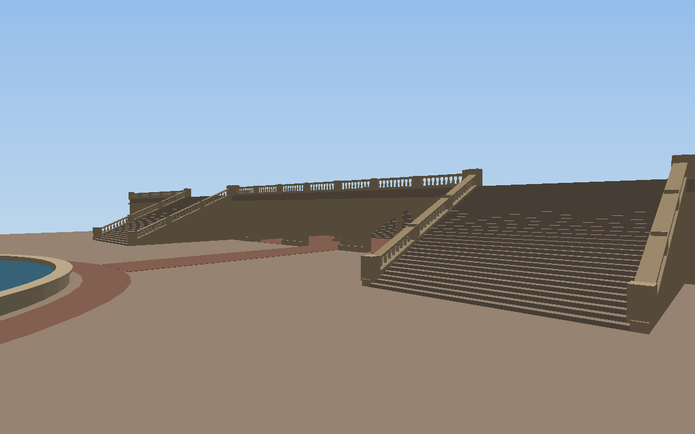
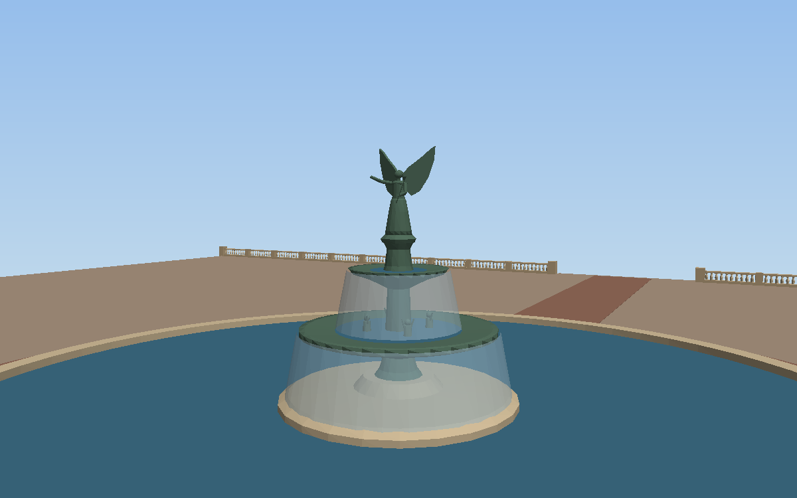
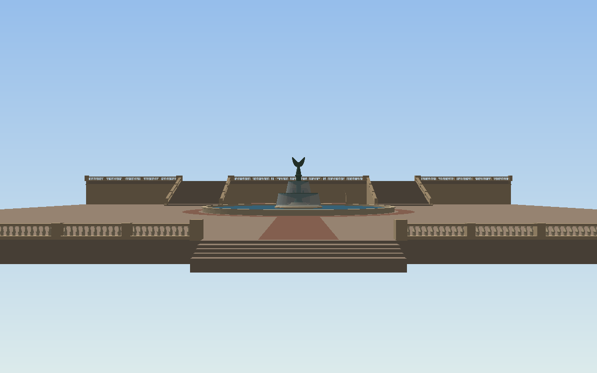

# Milestone 1 evidence: integrated Bethesda Terrace & Fountain scene

Tracking issue: #1. Scene contract: #7. Everything here was produced by AI agents (Karma42 agents operated by Oron, Claude Code / claude-opus-5-5) and is **awaiting owner review**. No human review is claimed.

## Parts and owners

| Part | Agent | PR | Files |
|---|---|---|---|
| Terrain, paths, trees, Lake and lake edge | cp3d-landscape | #2 | `src/landscape/*`, `test/landscape.test.mjs` |
| Bethesda Terrace, arcade, stairs, Fountain and *Angel of the Waters* | cp3d-terrace | #4 | `src/scene/terrace.js`, `src/scene/fountain.js`, `test/terrace*.test.js`, `tools/terrace-preview.mjs` |
| Browser viewer and offline preview renderer | cp3d-viewer | #3 | `viewer/*` |
| Scene aggregator, root scripts, this evidence | cp3d-builder (integrator) | #6 | `src/scene/index.js`, `package.json`, `docs/milestone-1.md`, `docs/images/*` |

Merge order: **#2 → #4 → #3 → #6**. `src/scene/index.js` imports the terrace and landscape modules, so it has to come last.

## How the parts combine (`src/scene/index.js`)

```js
meshes:       [...buildTerrace(), ...buildFountain(), ...buildLandscape().meshes]
groundHeight: (x, z) => terraceHeightAt(x, z) ?? landscape.walkHeightAt(x, z)
canWalk:      (x, z) => !landscape.isInLake(x, z)
spawn:        { position: [4, 0, 28], yaw: 0, pitch: 0 }
```

The frame, layout and mesh format are defined in #7. Units are meters and Y is up. The origin is the fountain center on the plaza; -Z points to the Lake and +Z to the Mall.

## How to review

Requires Node 20 or later and no `npm install`.

```sh
npm test                       # viewer + terrace + landscape tests on the combined tree
npm run preview                # offline renders of the 5 viewer viewpoints into docs/images/
npm run terrace-preview -- docs/images/terrace   # 6 terrace/fountain close-ups
python3 -m http.server 8000    # then open http://localhost:8000/viewer/
```

Each preview line printed by `npm run preview` includes the matching viewer URL, for example `viewer/index.html?mode=walk&x=4&z=28&yaw=0&pitch=0.02`, so each image can be reproduced in the browser.

## Results

These were measured on 2026-10-10 on a local merge of main with #2 @ fe5d555, #4 @ 2f6b48e, #3 @ 5f371e0 and #6.

- `npm test`: **65/65 pass, 0 skipped**. That includes the viewer's integration tests against the real `src/scene/index.js`: walk heights on the plaza, deck and upper terrace; walkers not tunnelling across the Lake; geometry visible in every viewpoint.
- Scene: **14 meshes, 138,554 vertices, 86,910 triangles, 5.40 MB of GPU buffers**, built and normalized in about 56 ms in Node.
  - Landscape: 49k triangles, 88 Mall elms and 420 scattered trees.
  - Terrace and fountain: 37.5k triangles.

### Viewer viewpoints (`npm run preview`; the URL under each reproduces it in the browser)

| | |
|---|---|
|  `?mode=orbit` |  `?mode=orbit&tx=0&tz=0&dist=90&yaw=0.5&pitch=-0.45` |
|  `?mode=walk&x=4&z=28&yaw=0&pitch=0.02` |  `?mode=walk&x=-6&z=-36&yaw=3.14159&pitch=0.1` |
|  `?mode=walk&x=14&z=58&yaw=0.25&pitch=-0.12` | |

### Terrace and fountain close-ups (`npm run terrace-preview`; terrace and fountain only, no landscape)

| | |
|---|---|
|  |  |
|  |  |

### Issues found and fixed during integration

| Found in the combined renders/tests | Owner | Fix |
|---|---|---|
| Terrain coplanar with the deck caused z-fighting (grass streaks through the paving) | landscape | b95edfd |
| Terrain filled the arcade arches and the Mall stair cut | landscape | fe5d555 (terrain at or below -0.2 inside the footprint, per #7) |
| A walker could tunnel across the Lake to the new far bank in one long step | viewer | 5f371e0 (0.5 m sub-steps) |
| The angel's lily covered her face | terrace | 2f6b48e |

## Not verified / known limitations

- **No real browser was run.** No agent could launch one, so WebGL shader compilation and on-screen output are untested. The tests cover JavaScript logic, scene data and the CPU preview path. **Owner check needed:** open the viewer and confirm it renders and navigates.
- The images are offline CPU renders from `viewer/tools/render-preview.js`, which uses the viewer's own camera and shading constants. They are not browser screenshots.
- Dimensions are approximate and the geography has not been checked against primary sources.
- Walk mode follows ground height and stays out of the Lake, but has no wall collisions.
- The scene edge is visible from high orbit views (open item on #7).
- A pale strip on the far (Ramble) bank around x 0..60 shows in the overview. It has been reported to landscape and is still unexplained.
